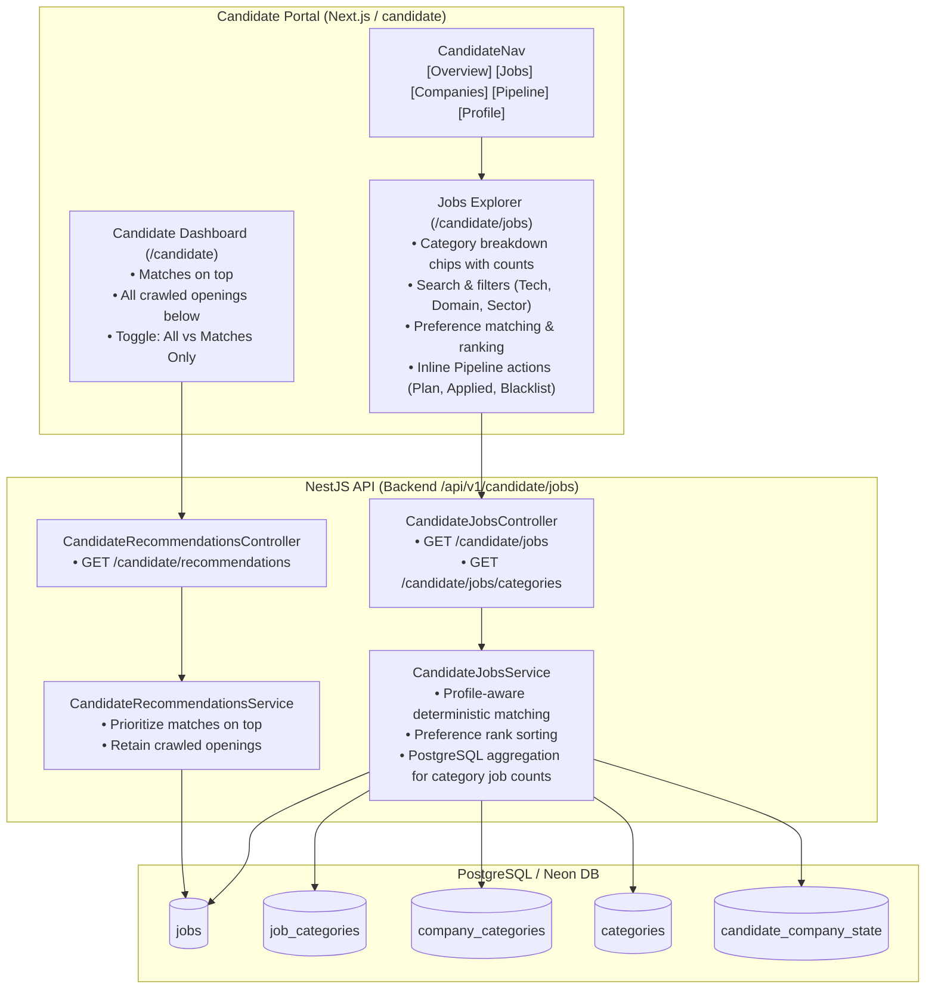

# Implementation Plan — Candidate Jobs Catalog & Category Breakdown

Enable candidates to view all crawled job openings (with preference-matched jobs prioritized on top), provide an active category intelligence breakdown ("which category how many jobs"), and add a dedicated **Jobs** explorer in the candidate portal.

---

## Architecture Overview

---

## 1. Candidate Dashboard Enhancements (`/candidate`)

1. **All Crawled Jobs with Matches Prioritized at Top**:
   - `CandidateRecommendationsService`: Evaluates candidate's active profile using `deterministicMatch()`.
   - Jobs matching the candidate's criteria are tagged `isMatch: true` and sorted to the top by `score` descending.
   - Non-matching crawled jobs are included below them (sorted by `first_seen_at` / `id` descending), giving candidates complete visibility over all scraped openings.
   - Candidate-blacklisted companies (`EXCLUDED`) remain strictly excluded.
2. **Dashboard UI Updates** (`recommendations.tsx`):
   - Added filter pill toggle: `All Openings (count)` vs. `Matches Only (count)`.
   - Clear visual status: Green `Profile Match` and `Match: XX%` for matched jobs; neutral `Crawled Opening` badge for general openings.
   - Direct link to `/candidate/jobs`.

---

## 2. Candidate Navigation

- Added `Jobs` link to [`candidate-nav.tsx`](file:///home/chillpc/MohammadSheakh/projects/26/job-intelligence-prd-db-switch-ready/job-intelligence-prd-db-switch/frontend/app/candidate/components/candidate-nav.tsx):
  `Overview · Jobs · Companies · Pipeline · Profile`

---

## 3. Dedicated Candidate Jobs Page (`/candidate/jobs`)

- Created [`frontend/app/candidate/jobs/page.tsx`](file:///home/chillpc/MohammadSheakh/projects/26/job-intelligence-prd-db-switch-ready/job-intelligence-prd-db-switch/frontend/app/candidate/jobs/page.tsx) complying with the Ferio Design System:
  - **Unboxed KPI Metrics**: `Total Openings`, `Matched to You`, `Categories with Jobs`, `Preference Ranking`.
  - **Category Breakdown Section ("which category how many jobs")**:
    - Group filters: `All`, `Technologies`, `Domains`, and `Sectors`.
    - Interactive badges with open job counts (e.g. `Node.js (15)`, `React (12)`, `Fintech (8)`).
    - Clicking any badge instantly filters the jobs list below.
    - Expandable `Detailed Job Counts` table organized by group.
  - **Filters & Search**:
    - Search input (title, company, skills, location).
    - Technology, Domain, Sector dropdowns.
    - Match Scope dropdown (`Any`, `Job Role Only`, `Company Only`).
    - Work Mode (`Remote`, `Hybrid`, `On-site`).
    - Sort Mode: `Matches First (Top)` vs `Most Recently Crawled`.
    - Checkbox: `Only show jobs matching my profile preferences`.
  - **Interactive Clean Table**:
    - Job title & company name with external links (`↗`).
    - Clickable category tags inside table rows that filter by that category.
    - Inline candidate pipeline status buttons: `Plan`, `Applied`, and `Blacklist` with instant UI feedback.
    - Application link `Apply ↗`.
    - Pagination (Previous / Next).

---

## 4. Backend Candidate Jobs API

- **DTO**: [`candidate-jobs-query.dto.ts`](file:///home/chillpc/MohammadSheakh/projects/26/job-intelligence-prd-db-switch-ready/job-intelligence-prd-db-switch/backend/src/features/candidate-portal/dto/candidate-jobs-query.dto.ts)
- **Service**: [`candidate-jobs.service.ts`](file:///home/chillpc/MohammadSheakh/projects/26/job-intelligence-prd-db-switch-ready/job-intelligence-prd-db-switch/backend/src/features/candidate-portal/services/candidate-jobs.service.ts)
  - `list(candidateId, query)`: Fetches candidate profile, checks candidate blacklist, queries jobs with relations, scores each opening with `deterministicMatch`, and prioritizes matches at the top.
  - `getCategoryJobCounts()`: Executes distinct SQL aggregation across `job_categories` and `company_categories` for OPEN jobs.
- **Controller**: [`candidate-jobs.controller.ts`](file:///home/chillpc/MohammadSheakh/projects/26/job-intelligence-prd-db-switch-ready/job-intelligence-prd-db-switch/backend/src/features/candidate-portal/controllers/candidate-jobs.controller.ts)
  - `GET /api/v1/candidate/jobs`
  - `GET /api/v1/candidate/jobs/categories`
- **Unit Tests**: [`candidate-jobs.service.spec.ts`](file:///home/chillpc/MohammadSheakh/projects/26/job-intelligence-prd-db-switch-ready/job-intelligence-prd-db-switch/backend/src/features/candidate-portal/services/candidate-jobs.service.spec.ts)

